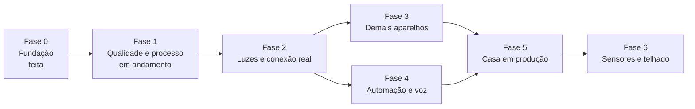

# Roadmap

Atualizado a cada Pull Request que muda a situação de uma fase. O quadro Kanban mostra o dia a dia; este arquivo mostra o caminho e o que depende de quê.

Situação em **19/11/2026** (atualizado no Pull Request da issue #25).

## Visão geral

## Fase 0: Fundação (feita)

Painel de demonstração, planta 3D com editor de portas e janelas, cenas, regras, horários, ponte com o Home Assistant, testes (lógica e funcionais), documentação, repositório e backlog.

## Fase 1: Qualidade e processo (em andamento)

| Issue | O quê | Estado |
|---|---|---|
| #27 | Processo de trabalho e roadmap | feito |
| #24 | Testes BDD com Robot Framework e GitHub Actions | feito (11 cenários; o restante em #26) |
| #25 | Kanban atualizado automaticamente | em teste: falta o token `PROJECT_TOKEN` (docs/KANBAN.md) |
| #26 | Portar os 27 testes JavaScript para Robot | backlog |
| #28 | Fluxo de produção e teste de fumaça | backlog |

Saída da fase: todo Pull Request passa por testes automáticos, e o quadro se atualiza sozinho.

## Fase 2: Luzes e conexão real

Depende do Home Assistant com o Tuya já conectado (feito na máquina virtual).

| Issue | O quê | Estado |
|---|---|---|
| #23 | Tuya: indisponíveis, duplicados e sem Área | pronto (tarefa do usuário) |
| #1 | Assistente de canais (nomear e classificar cada botão) | pronto para fazer |
| #12 | Gerar token e conectar o painel | pronto para fazer |
| #11 | Hospedar o painel no Home Assistant | pronto para fazer |
| #19 | Nomes editáveis para todos os dispositivos | backlog |
| #18 | Revisar portas e janelas da planta | pronto para fazer |

Saída da fase: acender uma luz da casa pelo painel real, no tablet.

## Fase 3: Demais aparelhos

| Issue | O quê | Depende de |
|---|---|---|
| #6 | TVs (LG e Android TV) | já descobertas no Home Assistant |
| #3 | Sonoff/eWeLink (persianas) | integração instalada |
| #4 | Daikin (3) e marca dos outros 2 | adaptador Wi-Fi e marca |
| #5 | Magic Home | integração |
| #7 | Câmeras Intelbras (6) | RTSP ativo, go2rtc |
| #8 | Câmeras Tapo (2) | conta de câmera |
| #2 | Cenas do Home Remote (ração, aspirador, abrir porta) | usuário descrever cada botão |
| #10 | Portão automático | usuário descrever o acionamento |
| #9 | Interfone Allo Plus | modelo do interfone |

## Fase 4: Automação e voz

| Issue | O quê | Depende de |
|---|---|---|
| #13 | Exportar cenas, regras e horários e testar no Home Assistant real | fase 2 |
| #22 | Alexa dizendo as frases das cenas | fase 4 (#13) |

## Fase 5: Casa em produção

| Issue | O quê | Depende de |
|---|---|---|
| #14 | Migrar da máquina virtual para o notebook definitivo | notebook |
| #20 | Tablet em modo quiosque | tablet |
| #21 | Acesso de fora e segurança | decisão (Nabu Casa, Tailscale ou VPN) |

## Fase 6: Sensores e telhado (futuro)

| Issue | O quê |
|---|---|
| #15 | Sensores de porta |
| #16 | Boiler: temperatura e nível |
| #17 | Telhado retrátil e sensor de chuva |
